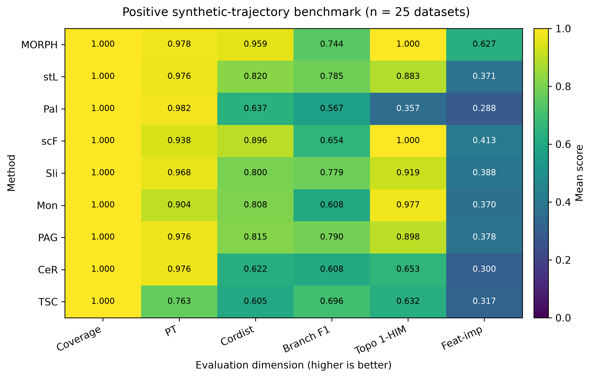
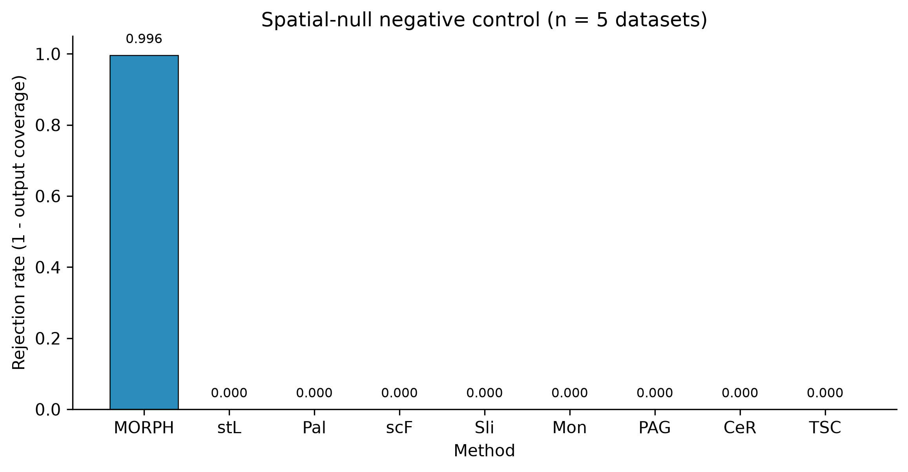

# MORPH trajectory evaluation

This repository is a clean, auditable scoring layer for the **unchanged** MORPH benchmark
simulation and its frozen native method predictions. It adds the requested six-part
evaluation panel without regenerating data or refitting any method:

| Method | Coverage | PT | Cordist | Branch F1 | Topo 1-HIM | Feat-imp |
|---|---:|---:|---:|---:|---:|---:|
| MORPH | 1.0000 | 0.9784 | 0.9587 | 0.7438 | 1.0000 | 0.6271 |
| stL | 1.0000 | 0.9761 | 0.8204 | 0.7851 | 0.8834 | 0.3711 |
| Pal | 1.0000 | 0.9815 | 0.6369 | 0.5669 | 0.3574 | 0.2878 |
| scF | 1.0000 | 0.9383 | 0.8958 | 0.6543 | 1.0000 | 0.4133 |
| Sli | 1.0000 | 0.9677 | 0.8004 | 0.7791 | 0.9194 | 0.3883 |
| Mon | 1.0000 | 0.9039 | 0.8080 | 0.6079 | 0.9771 | 0.3704 |
| PAG | 1.0000 | 0.9761 | 0.8145 | 0.7904 | 0.8985 | 0.3784 |
| CeR | 1.0000 | 0.9761 | 0.6222 | 0.6084 | 0.6532 | 0.3000 |
| TSC | 0.9996 | 0.7635 | 0.6046 | 0.6955 | 0.6317 | 0.3165 |

The headline table uses the 25 positive trajectory-recovery datasets. Five
`spatial_null` datasets are reported separately as a negative-control rejection
diagnostic in `results/spatial_null_negative_control.csv` and are not averaged into
trajectory accuracy.

`Pal` and `CeR` did not export a unique native tree. To keep the heatmap complete,
their topology is a declared `derived_fate_star` built from native fate/macrostate
labels and a common early trunk. This surrogate is used only for Topo 1-HIM and is
distinguished from native graphs in the audit column `topology_mode`.





## Why Branch F1 changed

The old hard branch score treated every cell as belonging to exactly one edge segment.
That construction is brittle for a trajectory forest: shared progenitor cells genuinely
belong to multiple downstream root-to-leaf lineages, and different methods subdivide
the same path at different resolutions.

The headline Branch F1 now compares **overlapping root-to-leaf lineage cell sets**.
For each true lineage, its best predicted lineage is found by Jaccard overlap (recovery);
the reverse mapping gives relevance, and their harmonic mean is reported. This raises
the score for a principled reason—shared trunks and harmless degree-two subdivisions
no longer count as branch failures. Wrong fates, missed splits and wrong cell placement
still lower the score. The previous exclusive segment score remains in
`results/by_root.csv` as `segment_f1_audit`.

## Repository layout

```text
trajectory_evaluation/
├── README.md
├── CITATION.cff
├── pyproject.toml
├── requirements.txt
├── run.py
├── docs/
│   ├── METRICS.md          # exact formulas, fallbacks and aggregation
│   ├── LITERATURE.md       # published benchmark basis
│   └── PAPER_TEXT_REVISION.md # manuscript-ready Chinese/English wording
├── src/morph_eval/
│   ├── cli.py
│   ├── evaluator.py
│   └── metrics.py
├── tests/test_metrics.py
├── scripts/
│   ├── make_figure.py
│   ├── rebuild_summaries.py
│   ├── refresh_topology.py
│   └── validate.py
├── figures/                # PNG, SVG and PDF
└── results/
    ├── manuscript_table.csv
    ├── summary_long.csv    # bootstrap 95% CI + n_valid/n_planned
    ├── summary_all_conditions_long.csv
    ├── spatial_null_negative_control.csv
    ├── by_dataset.csv
    ├── by_root.csv         # complete audit columns
    ├── provenance.json
    ├── validation.json
    └── SHA256SUMS.json
```

## Reproduce

Python 3.10+ is required. From this directory:

```bash
python -m venv .venv
.venv/Scripts/pip install -e .
python run.py --source "PATH/TO/FROZEN_BENCHMARK"
python scripts/validate.py
python scripts/make_figure.py
```

On Linux/macOS, use `.venv/bin/pip`. Pass `--source` to identify the frozen benchmark input. The source directory
must contain `data/partitions.csv`, `data/<case>/...`, `results/predictions/`, and
`results/status/` from the frozen benchmark.

The evaluator writes only under this repository. It never edits the source simulation,
truth, prediction or status files. Reference random-forest fits are cached under
`results/cache/` (ignored by Git); published CSV results are tracked.

## Interpretation and reporting

- Use `manuscript_table.csv` for the compact figure/table.
- Use `summary_long.csv` when reporting uncertainty and valid denominators.
- Use `spatial_null_negative_control.csv` for the separate null-rejection analysis.
- Use `by_root.csv` to audit every fallback, missing structural output and both branch
  definitions.
- Coverage must accompany quality metrics; it should not be multiplied into them.
- Inspect `topology_mode` before comparing native graphs with derived fate-star
  surrogates. A missing per-run surrogate remains `NA` rather than being set to zero;
  the method-level heatmap mean is available for every method.

Metric definitions and design decisions are fully specified in
[`docs/METRICS.md`](docs/METRICS.md). The literature basis is in
[`docs/LITERATURE.md`](docs/LITERATURE.md).


## Archived results and verification scope

This package contains the supplied final scoring implementation and results for nine methods over 30 datasets (25 trajectory datasets and five spatial null controls). These results are a separate experiment from the repository's supplied-root simulation benchmark. The original source identifiers in results/provenance.json and method_id columns retain their recorded meanings. Full input data and native predictions are external inputs. Unit tests and stored-result validation can run from this checkout.
